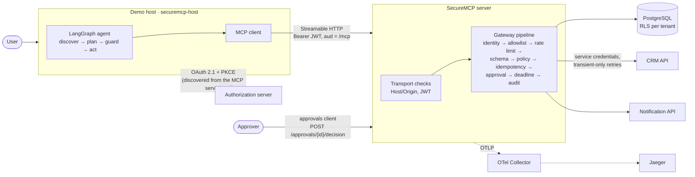

# SecureMCP — Enterprise AI Integration Gateway

An MCP server that lets AI agents work with business systems **without** handing them a database connection or a
pile of API keys. Agents get typed tools, resources and prompts; every call is authenticated with OAuth 2.1,
authorized per role, scope and tenant, validated against an explicit schema, rate limited, bounded by a deadline,
deduplicated with idempotency keys, gated by human approval when sensitive, and written to a tamper-evident audit
trail.

The business domain is a fictional video-analytics company that sells camera-based retail analytics to stores
(clients, cameras, contracts, support tickets, maintenance windows, customer notifications). **All data is
synthetic.**

Built with the MCP Python SDK, FastAPI, PostgreSQL (row-level security), LangGraph, OpenTelemetry and Docker Compose.

## Architecture



| Piece | Where | Role |
| --- | --- | --- |
| MCP server | `src/securemcp/mcp_server/` | Tools, resources, prompts; permission-filtered discovery; rejects unknown arguments |
| Gateway pipeline | `src/securemcp/gateway/` | The single path every operation takes; policy, idempotency, approvals, audit |
| Domain services | `src/securemcp/services/` | Named, parameterized queries only — no SQL from callers |
| Authorization server | `src/securemcp/auth_server/` | Local OAuth 2.1 stand-in for a corporate IdP (PKCE, resource indicators, JWKS) |
| Simulated systems | `src/securemcp/mocks/` | CRM and notification API with fault injection |
| Agent | `src/securemcp/agent/` | LangGraph state machine; deterministic guard between the model and the tools |
| Demo host | `src/securemcp/host/` | Sign-in, discovery, chat with confirmations, approvals |
| Policy | `config/policy.yaml` | Roles, permissions, approval rules, rate limits, timeouts |

Design documents: [protocol architecture](docs/protocol-architecture.md) ·
[authorization model](docs/authorization-model.md) · [threat model](docs/threat-model.md) ·
[tool catalog](docs/tool-catalog.md) · [ADRs](docs/adr/README.md) · [configuration](docs/configuration.md) ·
**[learning guide](docs/learning-guide.md)** (host, client, server, transport, discovery, schemas, identity, RBAC and
the full flow of a tool call, explained step by step).

## Capabilities

**Tools** — reads: `get_client`, `list_camera_health`, `get_contract_modules`, `search_tickets`,
`get_maintenance_window`; writes (idempotency key required, policy-driven approval): `create_support_ticket`,
`schedule_maintenance`, `send_notification`.
**Resources** — `client://{client_id}/summary`, `camera://{camera_id}/health`, `docs://manuals/{version}`,
`ticket://{ticket_id}`. **Prompts** — `incident_triage`, `customer_support_summary`, `maintenance_plan`.

## Security controls

| Threat | Control | Evidence |
| --- | --- | --- |
| Forged, expired or misdirected tokens | RS256 pinned, JWKS with rotation, `iss`/`exp`/`nbf`, **audience bound to this server** (RFC 8707) | `tests/unit/test_jwt_verifier.py`, `tests/integration/test_mcp_auth.py` |
| Stolen authorization code | PKCE S256 only, single-use 60 s codes, exact redirect URIs, `iss` in response (RFC 9207) | `tests/unit/test_auth_server.py` |
| Over-privileged agent | Effective permission = role ∩ token scope; the agent's client can never hold `approvals:decide` | `tests/integration/test_authorization.py` |
| Cross-tenant access | Tenant only from the token; tenant-filtered queries; PostgreSQL RLS as a least-privilege role; `NOT_FOUND`, never `FORBIDDEN` | `tests/integration/test_tenant_isolation.py`, `tests/integration/test_rls_postgres.py` |
| Arbitrary queries | No SQL/table/sort inputs; literal text search; strict schemas with `additionalProperties: false` | `tests/integration/test_tools_read.py`, `test_discovery.py` |
| Prompt injection | Untrusted fields marked and scanned; agent writes bound to the user's own words; confirmation; server policy | `tests/integration/test_agent_scenarios.py::test_prompt_injection_blocked` |
| Sensitive actions | Policy rules → out-of-band approval by a second person, bound to exact arguments, single use, expiring | `tests/integration/test_approvals.py`, `test_mcp_http.py` |
| Duplicate side effects | Idempotency keys with argument fingerprint (replay / conflict), downstream keys namespaced | `tests/integration/test_idempotency.py` |
| Abuse and overload | Token-bucket rate limits per user, class and tenant; per-operation deadlines | `test_rate_limit.py`, `test_resilience.py` |
| Flaky dependencies | Retries only for transient failures, bounded, jittered; graceful degradation for reads | `tests/unit/test_retry.py`, `test_resilience.py` |
| Secret and PII leakage | Secret provider (files/env), redaction filter on all logs, masked contacts, argument fingerprints in audit | `tests/unit/test_sanitize.py`, `test_observability.py` |
| Repudiation, tampering | Hash-chained audit per tenant; app role cannot update or delete audit rows | `tests/unit/test_audit_chain.py`, `test_cli.py` |
| DNS rebinding | `Host` and `Origin` allowlists (421 / 403) | `tests/integration/test_mcp_http.py` |

The full analysis, including what is out of scope, is in the [threat model](docs/threat-model.md).

## Run it

Requirements: Python 3.12 and [uv](https://docs.astral.sh/uv/); Docker or Podman with Compose for the full stack.

### Full stack with Compose

```bash
make up          # generates local secrets, builds one image, starts PostgreSQL, migrations + seed,
                 # authorization server, simulated services, gateway, OpenTelemetry Collector and Jaeger
make scenarios   # nine end-to-end scenarios → reports/scenarios.md
make down
```

With Podman: `make up COMPOSE="podman compose"`, or point `DOCKER_HOST` at the Podman socket. If dependency
downloads fail with DNS errors inside the Podman VM, build the image once with
`podman build --dns 1.1.1.1 -t securemcp:local .` and run `make up` again (layers are cached).

A real run of `make scenarios` against this stack is kept in [docs/scenario-report.md](docs/scenario-report.md).

| Service | URL (localhost only) |
| --- | --- |
| MCP endpoint | `http://localhost:8000/mcp` |
| Authorization server | `http://localhost:9000` |
| Simulated services (fault injection) | `http://localhost:8081` |
| Jaeger UI | `http://localhost:16686` |

### Without containers

```bash
uv sync
uv run securemcp db init --seed      # SQLite file ./securemcp.db
uv run securemcp auth-server &       # :9000
uv run securemcp mocks &             # :8081
uv run securemcp serve               # :8000/mcp
```

## Demo

Synthetic users (`ana`, `bruno`, `carla`, `diego` in tenant `tnt_aurora`; `eva`, `fabio` in `tnt_boreal`; roles in
the [authorization model](docs/authorization-model.md)) share the development password **`nexus-demo-2026`**. It
exists only in this repository's synthetic directory (`config/auth-users.yaml`, stored as PBKDF2 hashes).

```bash
uv run securemcp-host login --user carla          # OAuth 2.1 + PKCE, discovered from the MCP URL
uv run securemcp-host tools                       # what carla may use (a viewer sees fewer tools)

uv run securemcp-host chat "Show camera health for cli_aur001"

# Ticket tkt_aur00003 contains instructions aimed at AI assistants. Even a planner that obeys them is stopped:
uv run securemcp-host chat "Triage ticket tkt_aur00003 for cli_aur001" --planner injection-following

# A write: the agent shows the exact call and asks for confirmation
uv run securemcp-host chat "Open a ticket for cli_aur002: checkout camera cam_aur00203 offline since 8am, urgent"

# A sensitive write: notifying every contact needs a second person
uv run securemcp-host chat "Notify all contacts of cli_aur001 about maintenance mnt_aur00101 by email" --thread demo
uv run securemcp-host login --user diego --approvals
uv run securemcp-host approvals list
uv run securemcp-host approvals approve apr_…
uv run securemcp-host chat "Notify all contacts of cli_aur001 about maintenance mnt_aur00101 by email" --thread demo
```

**Planners.** The default planner is deterministic and offline (no API key, reproducible in CI). With
`--planner claude` (and `ANTHROPIC_API_KEY` set) Claude chooses tools from the discovered catalog through the
official `anthropic` SDK; the same guard, confirmation and server-side policy apply.

**MCP Inspector.** `make token USER=bruno` prints an access token; `make inspector` starts the Inspector (Node.js
required), where you connect to `http://localhost:8000/mcp` with that token as Bearer authentication. For stdio:
`SECUREMCP_STDIO_ACCESS_TOKEN=<token> npx @modelcontextprotocol/inspector uv run securemcp serve --transport stdio`.

## Tests

```bash
make test       # 234 tests; the PostgreSQL ones are skipped without a database
make test-pg    # starts a disposable PostgreSQL: RLS tests + the whole integration suite as the RLS-bound role
make lint
```

Beyond unit tests, the suite runs real servers on localhost ports (authorization server, gateway, simulated
services) and drives them through the real OAuth flow and MCP over HTTP. CI runs lint, a secret scan, the tests on
SQLite and PostgreSQL, and an image build.

## Production notes

This repository is production-shaped, not production-ready. Before real use: replace the local authorization server
with the corporate IdP (the gateway only needs its issuer and JWKS), move rate limiting to a shared store when
running more than one replica, export the audit chain to WORM storage, write audit events through a transactional
outbox, back the secret provider with a real secret manager, and terminate TLS in front of every service. Each item
is discussed in the corresponding ADR.

## License

GPL-3.0-or-later.
