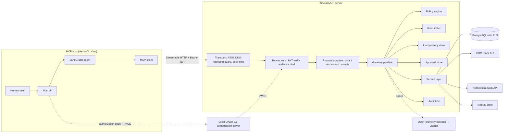

# Protocol architecture

SecureMCP is a **Model Context Protocol (MCP) server that acts as a security gateway** between AI agents and the
(simulated) business systems of Nexus Sight, a video-analytics company that sells camera-based retail analytics.
The server is not an LLM. It exposes a small, typed, audited set of capabilities; everything an agent can do goes
through it.



## 1. Roles in MCP terms

| MCP role | In this repository | Responsibility |
|---|---|---|
| **Host** | `securemcp.host` (CLI chat) | Owns the user experience, logs the user in, shows confirmations, decides which servers to trust. |
| **Client** | `mcp.Client` inside `securemcp.agent.mcp_client` | Holds one connection to one server, negotiates the protocol, sends JSON-RPC requests, attaches the bearer token. |
| **Server** | `securemcp.mcp_server` | Advertises tools, resources and prompts and executes them on behalf of an authenticated caller. |
| **Agent** | `securemcp.agent` (LangGraph) | Decides which capability to use next. Lives in the host process; it is *not* part of the protocol. |
| **Authorization server** | `securemcp.auth_server` | Issues short-lived JWT access tokens bound to the MCP server (audience). Separate trust domain. |

The server never sees the LLM prompt and never calls an LLM. It only sees typed requests from an authenticated
caller, which is why it can enforce policy deterministically.

## 2. Transports

| Transport | When | Identity source |
|---|---|---|
| **Streamable HTTP** (default, `POST /mcp`) | Docker Compose, remote hosts, Inspector | `Authorization: Bearer <JWT>` on every request, verified by the SDK bearer middleware with our `JwtTokenVerifier`. |
| **stdio** (`securemcp serve --transport stdio`) | Local experiments with desktop hosts | No HTTP headers exist, so the token is read from `SECUREMCP_STDIO_ACCESS_TOKEN` and verified exactly like an HTTP token. Without it every call is rejected. |

The HTTP app runs **stateless with JSON responses** (`stateless_http=True`, `json_response=True`). Every request is
authenticated on its own, no server-side MCP session holds authority, and horizontal scaling needs no sticky
sessions. The trade-off — no server-initiated streams (progress notifications, sampling, elicitation) — is acceptable
because no SecureMCP operation needs them. See [ADR-0001](adr/0001-mcp-python-sdk-streamable-http-stateless.md).

Transport hardening applied before any MCP logic runs:

- **DNS-rebinding protection** (`TransportSecuritySettings`): `Host`/`Origin` headers must match
  `SECUREMCP_ALLOWED_HOSTS` / `SECUREMCP_ALLOWED_ORIGINS`.
- **Request body limit** (SDK default, 4 MiB) — oversized JSON-RPC bodies are refused.
- **Bearer authentication** on `/mcp`; missing or invalid tokens get `401` with a `WWW-Authenticate` header that
  points to the Protected Resource Metadata (RFC 9728) at `/.well-known/oauth-protected-resource/mcp`.

## 3. Discovery and capability negotiation

1. The client connects. With the 2.x SDK it first probes `server/discover` (protocol `2026-07-28`) and falls back to
   the classic `initialize` handshake for older servers. Both paths return the server's name, version,
   instructions and capabilities (`tools`, `resources`, `prompts`).
2. The client calls `tools/list`, `resources/list`, `resources/templates/list` and `prompts/list`.
3. **Discovery is filtered by the caller's effective permissions** ([ADR-0011](adr/0011-permission-filtered-discovery.md)):
   a `viewer` never sees `send_notification`. Filtering is a usability and attack-surface measure; authorization is
   still enforced on every call.

Each tool advertises:

- `inputSchema` — JSON Schema generated from explicit, typed parameters (`Annotated[str, Field(pattern=…)]`),
  with `additionalProperties` closed by the SDK's argument model, length limits, enums and numeric ranges.
- `outputSchema` — JSON Schema generated from a Pydantic output model; results are returned as
  `structuredContent` plus a JSON text block for clients that ignore structured output.
- `annotations` — `readOnlyHint`, `destructiveHint`, `idempotentHint`, `openWorldHint`. These are *hints for the
  host* (for example, to decide when to ask the user for confirmation); the server never trusts them for security.
- `_meta.securemcp` — risk level, required scope and whether approval can be required, so hosts can render warnings.

## 4. Layering

```
src/securemcp/
  mcp_server/   protocol adapters: register tools/resources/prompts, translate errors to MCP results
  gateway/      protocol-independent pipeline: identity → allowlist → rate limit → policy → idempotency
                → approval → timeout → service → output validation → audit
  security/     JWT verification, principal, policy engine, rate limiter, sanitization, injection detection
  services/     business rules per domain (clients, cameras, contracts, tickets, maintenance, notifications, docs)
  db/           SQLAlchemy models, tenant-scoped repositories, RLS, synthetic seed data
  integrations/ HTTP clients for the CRM and notification APIs (timeouts, transient-only retries)
```

Rules that keep the layers honest ([ADR-0002](adr/0002-layered-gateway-no-generic-sql.md)):

- A protocol adapter is a few lines: build the typed input, call `gateway.invoke(...)`, return the typed output.
- The gateway does not know SQL; services do not know MCP.
- Repositories only expose **named, parameterised queries**, and every method takes `tenant_id` as its first
  argument. There is no `execute_sql` tool and no code path that accepts SQL text from a caller.
- `tenant_id` is never an input field of any tool, resource or prompt. It comes from the verified token only.

## 5. Life of a tool call

```mermaid
sequenceDiagram
    autonumber
    participant Ag as Agent (LangGraph)
    participant Cl as MCP client
    participant Tr as Transport + bearer auth
    participant Ad as Tool adapter
    participant Gw as Gateway pipeline
    participant Po as Policy engine
    participant Sv as Service
    participant Db as PostgreSQL (RLS)
    participant Au as Audit
    Ag->>Cl: call create_support_ticket(args)
    Cl->>Tr: POST /mcp tools/call + Bearer JWT
    Tr->>Tr: verify signature, iss, aud, exp; Host/Origin check
    Tr->>Ad: authenticated request (AccessToken in context)
    Ad->>Ad: SDK validates args against inputSchema
    Ad->>Gw: invoke("create_support_ticket", input, ctx)
    Gw->>Gw: principal from token (tenant, roles, scopes)
    Gw->>Gw: operation allowlist + rate limit
    Gw->>Po: evaluate(principal, operation, input)
    Po-->>Gw: allow | deny | approval_required (+policy id)
    Gw->>Gw: idempotency: new / replay / conflict
    Gw->>Sv: execute under deadline (timeout)
    Sv->>Db: SET app.tenant_id; parameterised INSERT
    Sv-->>Gw: typed result
    Gw->>Gw: validate output model, flag untrusted text
    Gw->>Au: append hash-chained audit event
    Gw-->>Ad: result
    Ad-->>Cl: CallToolResult(structuredContent)
    Cl-->>Ag: result (treated as untrusted data)
```

## 6. Errors

MCP distinguishes **protocol errors** (JSON-RPC `error`, e.g. unknown method, malformed request) from **tool
execution errors** (`CallToolResult.isError = true`, which the model can read and react to). SecureMCP uses:

| Situation | Surface | Body |
|---|---|---|
| Missing/invalid/expired token, wrong audience | HTTP `401` before MCP | `WWW-Authenticate: Bearer error="invalid_token", resource_metadata=…` |
| Tool arguments fail the input schema | `isError` result | `{"error": {"code": "INVALID_ARGUMENT", "fields": [...]}}` (field names only, never values) |
| Business or security refusal | `isError` result | `{"error": {"code": "FORBIDDEN" \| "NOT_FOUND" \| "RATE_LIMITED" \| …, "retryable": bool, "request_id": "…"}}` |
| Resource refusal | JSON-RPC error | `code=-32602` with `data.error.code` set to the SecureMCP code |
| Unexpected exception | `isError` result | `INTERNAL` with only the request id; the stack trace stays in server logs |

The complete error-code table lives in [tool-catalog.md](tool-catalog.md#error-codes).

## 7. Out-of-band HTTP endpoints

The MCP server also exposes a few plain HTTP routes on the same ASGI app:

| Route | Auth | Purpose |
|---|---|---|
| `GET /healthz`, `GET /readyz` | none | Liveness and readiness (database reachable). |
| `GET /.well-known/oauth-protected-resource/mcp` | none | RFC 9728 metadata: which authorization server protects `/mcp`. |
| `GET /approvals` | Bearer with `approvals:decide` | Pending approvals of the caller's tenant. |
| `POST /approvals/{id}/decision` | Bearer with `approvals:decide` | Approve or reject. Four-eyes: the requester cannot decide. |

Approvals are deliberately **not** MCP tools: an agent must never be able to approve its own action
([ADR-0007](adr/0007-out-of-band-approvals-four-eyes.md)).

## 8. Deployment view (Docker Compose)

| Service | Port | Image / command |
|---|---|---|
| `postgres` | 5432 | `postgres:17-alpine`; owner role for migrations, `securemcp_app` role (no `BYPASSRLS`) for the server |
| `auth` | 9000 | `securemcp auth-server` — OAuth 2.1 authorization server, JWKS |
| `mocks` | 8081 | `securemcp mocks` — CRM and notification APIs with fault injection |
| `migrate` | — | one-shot `securemcp db init --seed` (schema, RLS policies, grants, synthetic data) |
| `mcp` | 8000 | `securemcp serve` — the gateway |
| `otel-collector` | 4318 | OpenTelemetry Collector (OTLP/HTTP in, Jaeger out) |
| `jaeger` | 16686 | trace UI |
| `inspector` (profile `tools`) | 6274 | MCP Inspector for manual exploration |

The demo host and agent run on the developer machine (`securemcp-host …`) and talk to `localhost:8000/mcp`.
